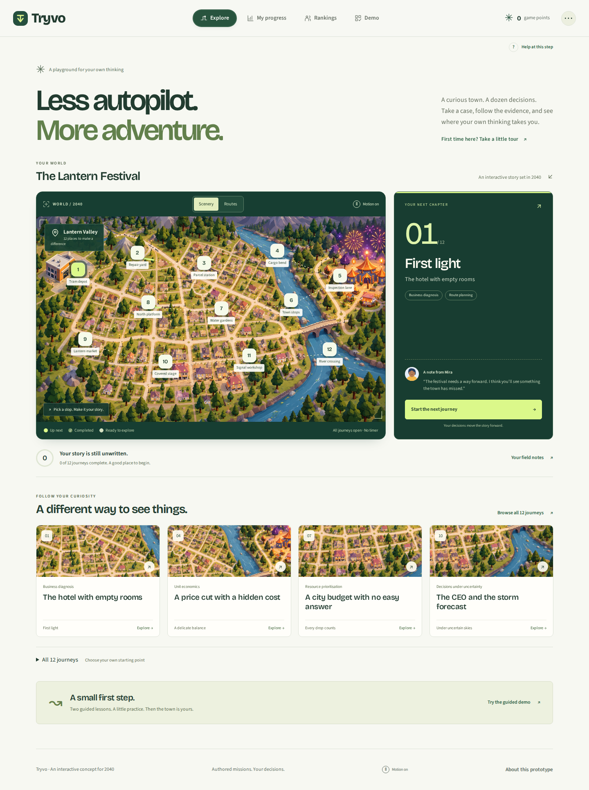
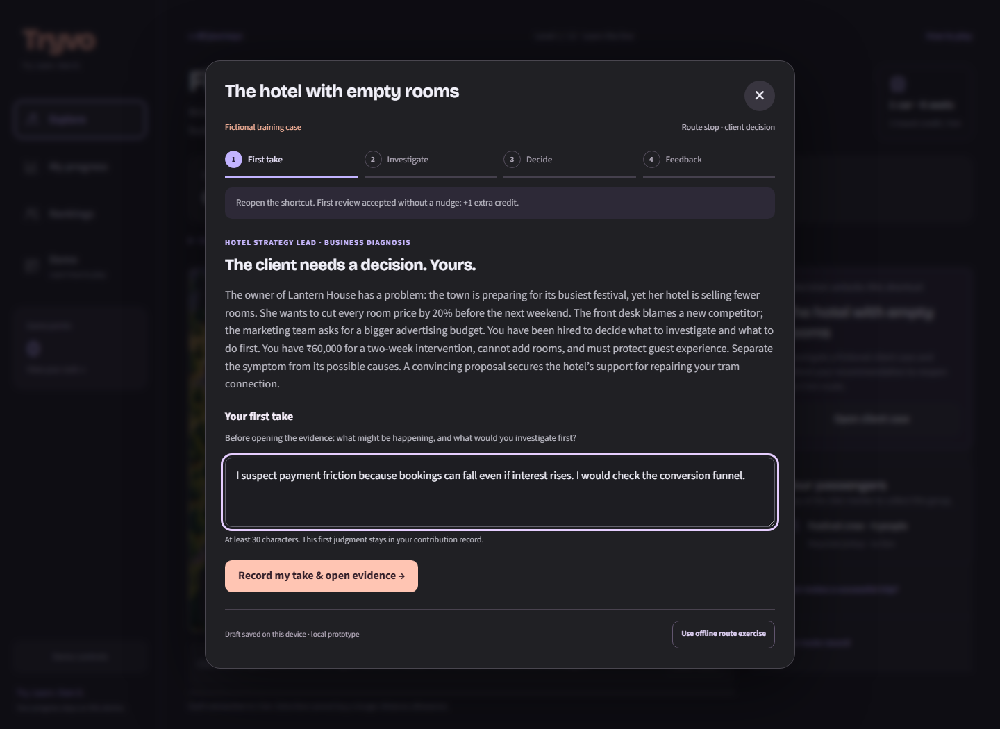
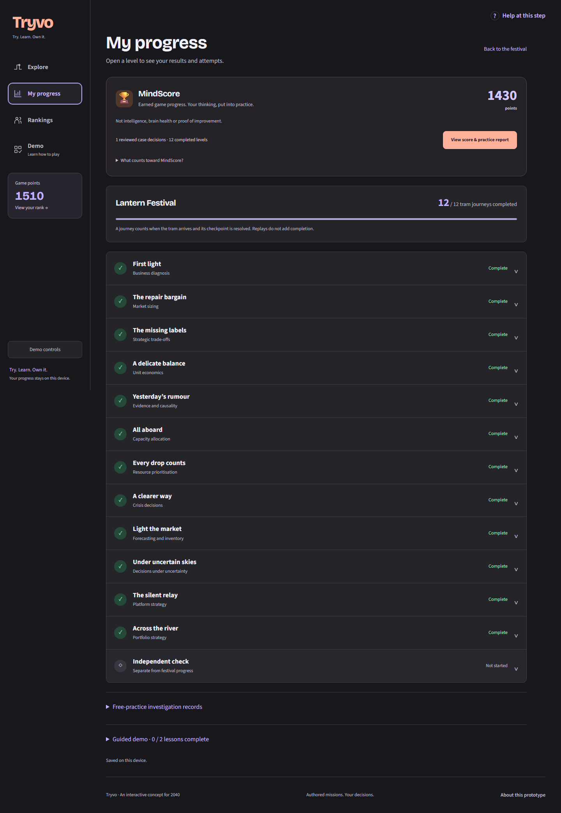

<div align="center">

# Tryvo
### Try. Learn. Own it.

**A world where your decisions move the story forward.**

Plan a tram route. Question a client. Defend a decision. See what happens next.

[The experience](#the-experience) · [Run locally](#run-locally) · [MindScore](#mindscore-and-your-practice-report) · [Architecture](#architecture) · [Tests](#tests)

</div>



## When AI can do the task, what do you still want to do yourself?

Tryvo explores that question through a speculative 2040 world where personal AI agents handle much of everyday life. Its starting hypothesis is simple: some people will still want opportunities to exercise their judgment, make meaningful choices and recognise what they personally contributed.

The product turns those opportunities into a connected game. A blocked tram route introduces a client who needs a decision. Your recommendation unlocks a connection or travel benefit. At arrival, new information asks you to reconsider. The reward follows a choice you made.

This is a working product prototype developed for a Flipkart APM case study. It is not an official Flipkart product, a cognitive assessment or a treatment.

## The experience

```text
Choose a journey → Make your first judgment → Investigate the evidence
                                                    ↓
                                    Question the AI client, if useful
                                                    ↓
Read specific feedback ← Defend your recommendation
          ↓
Unlock the shortcut → Build and run your tram → Respond to a new development
                                                       ↓
                                     See your contribution and next practice step
```

### One town. Twelve decisions.

Festival Rescue connects business reasoning with a playable transport network. Shortcuts, passenger fares, seat limits, repair costs and service stops make the route a decision in its own right. Later journeys introduce larger trams and tighter constraints.

| Case | The decision you practise |
| --- | --- |
| **The hotel with empty rooms** | Diagnose falling bookings before cutting prices |
| **How many pens does Kota buy?** | Build a market estimate from segments and explicit assumptions |
| **The CEO’s expansion choice** | Weigh growth against operational reliability |
| **A price cut with a hidden cost** | Compare contribution, capacity and cannibalisation |
| **The dashboard says demand is down** | Separate a signal from confounding changes |
| **Who gets the peak-hour tram?** | Allocate limited capacity across competing needs |
| **A city budget with no easy answer** | Prioritise investments under constraints |
| **The announcement that could backfire** | Communicate uncertainty and protect trust |
| **Sell out—or be left with stock?** | Make an inventory decision with incomplete demand data |
| **The CEO and the storm forecast** | Make a contingent decision under uncertainty |
| **Growth is hiding a trust problem** | Balance marketplace growth with quality and fairness |
| **The network you cannot build all at once** | Sequence a portfolio of transport investments |

All case figures, characters and outcomes are fictional. The Kota example uses authored planning assumptions, not a claim about actual market demand.

### A client you can question. A decision you have to own.

Each case has a substantial brief and three exhibits. Before guidance, you record your initial judgment. You can then question an AI client, examine the evidence and write a four-part recommendation:

1. **Decision:** what you would do and why.
2. **Evidence:** the facts, calculations and assumptions behind it.
3. **Trade-off:** the alternative you considered and what you give up.
4. **Next test:** the evidence that would make you change your mind.

Groq powers the client conversation and case feedback. The model scores four rubric dimensions; server code determines acceptance and the game engine applies the reward. A recommendation needs at least **5/8**, with **no missing dimension**. There can be multiple defensible answers.



### Learn the controls before taking the case

Two guided Demo lessons teach route building, obstructions, fares and operating costs with contextual instructions. They stay offline and do not award campaign points. Every client case also offers an **offline route exercise** when the AI service is unavailable or you prefer numeric practice.

## MindScore and your practice report

**MindScore is accumulated eligible game progress—not intelligence, brain health or proof of improvement.**

It recognises first-pass, unhinted case work and qualifying route achievements. Replays cannot farm points. The dashboard keeps recorded AI-client assistance separate, and preserves the broader game-point leaderboard under its existing rules. No recorded client chat is not proof of independence.

On request, the AI practice coach reviews your saved judgments, recommendations and feedback. Its report cites the supporting case decisions and suggests **three short practice exercises** you can do in the game or on paper. Reports persist across refresh and reuse unchanged evidence.



*The screenshot uses demonstration progress. Your own dashboard starts from your saved attempts.*

The report cannot determine whether AI is harming a person's mind, diagnose cognitive decline or prescribe a “brain reset.” Enjoyment, earned satisfaction, independent performance and longer-term learning are separate questions that require appropriate testing.

## Run locally

**Requirements:** Python 3.10+ and a modern browser. No frontend build step or Python packages are required.

```sh
git clone https://github.com/aadishjainiitd-svg/Tryvu.git
cd Tryvu
python prototypes/tryvo/server.py --port 8765
```

Open **[http://127.0.0.1:8765](http://127.0.0.1:8765)**. Use `python3` if that is your Python command. Keep the server running while using the prototype.

### Enable the AI client and reports

Copy the supplied template to **`.env.tryvo` in the repository root**:

```sh
# macOS / Linux
cp .env.example .env.tryvo
```

```powershell
# Windows PowerShell
Copy-Item .env.example .env.tryvo
```

Edit the local copy:

```dotenv
GROQ_API_KEY=your_private_groq_key
GROQ_MODEL=openai/gpt-oss-120b
```

Use a model available to your Groq account. This integration uses **Groq**, not xAI Grok. Requests consume your provider quota and may incur provider charges. With no key, use **Demo** and the explicit **offline route exercise**; the interface never pretends an offline response came from AI.

Serve the application with `server.py` for local development. Static hosting uses the separate Render backend configured below. The example configuration contains no credential.

### Vercel frontend and Render backend

The hosted frontend at **https://tryvu-tryvo.vercel.app** sends its case and practice-report requests to **https://tryvu-5.onrender.com**. The public API base is defined once in `prototypes/tryvo/js/api-config.js`; localhost development continues to use the local Python server. This is a plain JavaScript site with no build step, so no `NEXT_PUBLIC_API_URL`, `VITE_API_URL` or `REACT_APP_API_URL` variable is needed.

- **Vercel:** deploy `main` with Root Directory `prototypes/tryvo` and Framework Preset **Other**. The existing project can redeploy after the GitHub push.
- **Render:** deploy the same branch with start command `python prototypes/tryvo/server.py`. If the service Root Directory is `prototypes/tryvo`, use `python server.py`. The server reads Render's `PORT` automatically; `--port` remains available for local use.
- Set `GROQ_API_KEY` and optionally `GROQ_MODEL` in **Render's** environment. Never put the private key in Vercel frontend JavaScript.
- Check `https://tryvu-5.onrender.com/api/health`: HTTP 200 with `configured: true` means the server can see its configured key; it does not validate the key with Groq.
- CORS supports `GET`, `POST`, `OPTIONS`, `Content-Type` and the frontend's `X-Tryvo-Client` header, including API error responses. By default it allows any origin as requested for this prototype. Optionally set `TRYVO_ALLOWED_ORIGINS=https://tryvu-tryvo.vercel.app` in Render to restrict access from browsers; add other exact origins separated by commas if needed.

If automatic deployment is disabled, deploy the latest commit in both dashboards. A Render restart without persistent storage may clear existing case sessions; start a fresh case if an older session is unavailable.

### A useful first walkthrough

1. Open **Demo** and try “Your first connection.”
2. Choose a journey on **Explore** and click **Open client case**.
3. Record your first take, open exhibits and ask the client a question.
4. Submit a recommendation, revise if necessary and unlock the route.
5. Run the tram, respond to the arrival development and inspect **My progress**.
6. Open **MindScore → Generate AI report** after a reviewed case.

## Architecture

Plain **HTML, CSS and vanilla JavaScript** form the interface. A small **Python standard-library server** serves the app and proxies AI requests. SQLite retains local case sessions and cached reports.

```text
Tryvu/
├── .env.example                  Safe configuration template
├── .gitignore                    Credentials, databases and generated files excluded
└── prototypes/tryvo/
    ├── index.html                Application shell
    ├── css/                      Responsive interface and game styling
    ├── js/
    │   ├── rescue-engine.js      Route economics and one-time awards
    │   ├── case-workbench.js     Brief → evidence → decision → feedback
    │   └── mindscore.js          Eligible points and practice-report interface
    ├── assets/                   Local artwork, fonts and authored case dossiers
    ├── server.py                 Local web server and Groq case API
    ├── report_service.py         Evidence-linked practice reports
    ├── tests/                    Engine, API and browser checks
    └── vendor/                   Retained third-party license notices
```

| Boundary | Responsibility |
| --- | --- |
| Authored case dossiers | Keep the scenario and exhibits consistent |
| AI client and reviewer | Discuss evidence and critique a recommendation |
| Server validation | Validate response shape, citations and acceptance criteria |
| Game engine | Apply route constraints, credits and non-repeatable awards |
| Browser state | Preserve non-sensitive demo progress on this device |

The two case-bank files—`assets/business-cases.json` and `js/case-data.js`—must stay in sync when editing scenarios.

## Credentials and data

- Real `.env` files are ignored at every directory level. **Only `.env.example` is intended for Git.**
- API keys remain server-side, outside the served web directory. They are never placed in JavaScript or localStorage.
- `.tryvo-local/`, local databases, logs and generated AI reports are excluded from version control.
- Case requests have payload limits, rate limits, response validation and retry caching. The server listens on `0.0.0.0`, accepts local and configured Render hosts, and supports optional browser-origin restrictions.
- Use fictional information. Case text is sent to Groq when you request AI conversation, review or reporting.
- **Reset Demo** clears browser progress and its saved report. It does not delete the private server-side session store. To remove that store, stop the server and remove the repository's `.tryvo-local` folder.
- Rotate any API key that has been shared or exposed. A `.gitignore` rule cannot revoke an already exposed credential.

## Tests

Run the deterministic checks from the repository root:

```sh
node prototypes/tryvo/tests/economy-engine.cjs
node prototypes/tryvo/tests/cases-engine.cjs
python prototypes/tryvo/tests/cases-server.py
python prototypes/tryvo/tests/report-server.py
python prototypes/tryvo/tests/deployment-http.py
node prototypes/tryvo/tests/api-config.cjs
```

For browser checks, install Node.js and Playwright, then start the local server in another terminal:

```sh
npm install --no-save playwright
npx playwright install chromium
node prototypes/tryvo/tests/cases-browser.cjs
node prototypes/tryvo/tests/mindscore-browser.cjs
node prototypes/tryvo/tests/economy-browser.cjs
node prototypes/tryvo/tests/tutorial.cjs
node prototypes/tryvo/tests/tutorial-preservation.cjs
```

Browser coverage includes case revisions, unavailable AI, retry recovery, saved drafts, one-time rewards, mobile layouts at 320/390px, keyboard controls, reset and preservation of older progress. AI-path browser tests use controlled responses; they do not spend provider credits or establish model quality. A live Groq conversation, case review and practice report were also smoke-tested during development.

## What is real—and what is simulated

**Implemented:** twelve tram journeys, twelve case dossiers, live AI client discussion and review, contextual tutorials, persistent progress, MindScore, AI practice reports and a leaderboard that places your actual game score among fictional rivals.

**Simulated:** transport operations, business outcomes, travel credits and other players. There are no real transactions or remote multiplayer sessions.

**Still to validate:** repeat demand, grading consistency, whether achievement feels personally earned and whether practice helps on unfamiliar tasks. Scores, retention and a single independent check cannot answer all of those questions.

This is a local prototype. Public deployment needs authentication, user-specific quotas, retention controls and server-owned scores. Browser-local scores are editable by their owner and are not suitable for a competitive production leaderboard.

## Design and attribution

The current **Field Guide** design uses a warm-white canvas, forest-green actions, locally bundled typography and an illustrated town as its visual anchor. Explore, route play, guided lessons, client cases, progress, reports and rankings share the same presentation system. See [DESIGN.md](DESIGN.md) for tokens and responsive rules, and [redesign verification](research/design-revamp-verification.md) for exercised flows and limitations.

The **Future Atlas** motion pass adds moving route highlights, a Scenery/Routes map selector, pointer-responsive depth, unfolding headlines, staggered cards and dialog entrances. Pause decorative motion from the map toolbar or footer; device reduced-motion settings take precedence. The effects use native CSS/SVG/Web Animations and leave game state unchanged.

Run the additional responsive/visual regression checks with the local server running:

```sh
node prototypes/tryvo/tests/fieldguide-browser.cjs
node prototypes/tryvo/tests/motion-browser.cjs
```

These tests write screenshots to your OS temporary directory by default. Set `TRYVO_SCREENSHOT_DIR` to choose another output directory. AI behavior is not exercised by these visual suites.

Tryvo starts from **HTML5 Boilerplate** and adapts selected interaction patterns from **Brad Traversy's 50projects50days**. License notices for those projects and bundled fonts are retained. See [ATTRIBUTION.md](prototypes/tryvo/ATTRIBUTION.md), the [Boilerplate notice](prototypes/tryvo/LICENSE.txt) and `vendor/` for the relevant terms.

Further implementation notes: [Business cases](prototypes/tryvo/BUSINESS-CASES.md) · [Route economy](prototypes/tryvo/ECONOMY.md) · [Guided demo](prototypes/tryvo/DEMO-DESIGN.md).

---

**Make the attempt worth choosing, the contribution visible and independent progress testable.**
