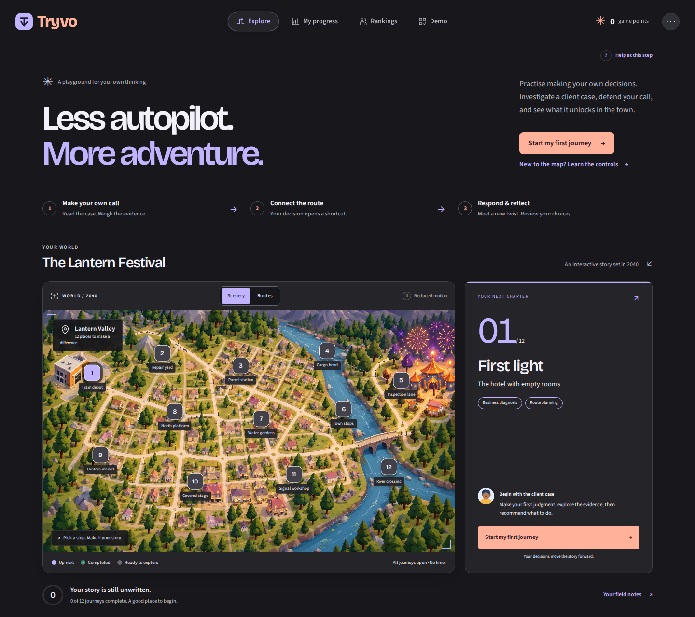
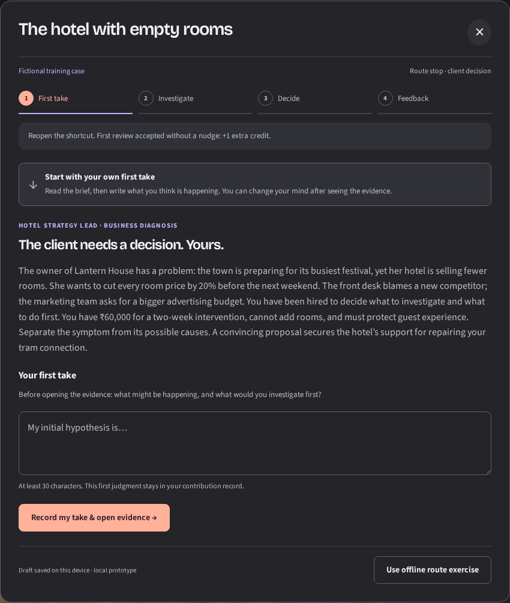
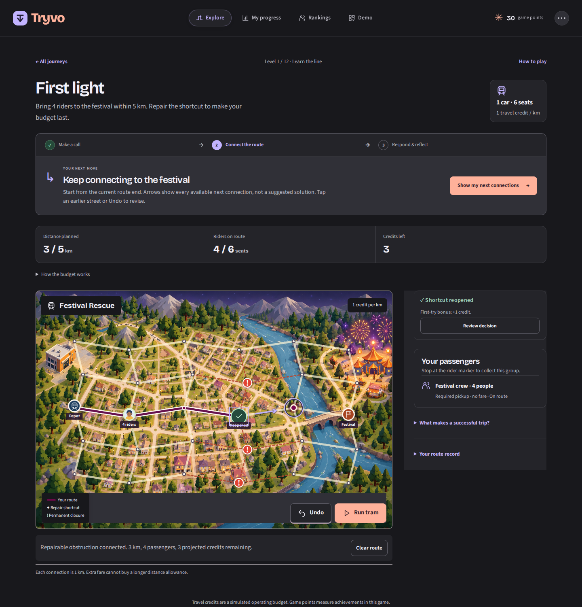
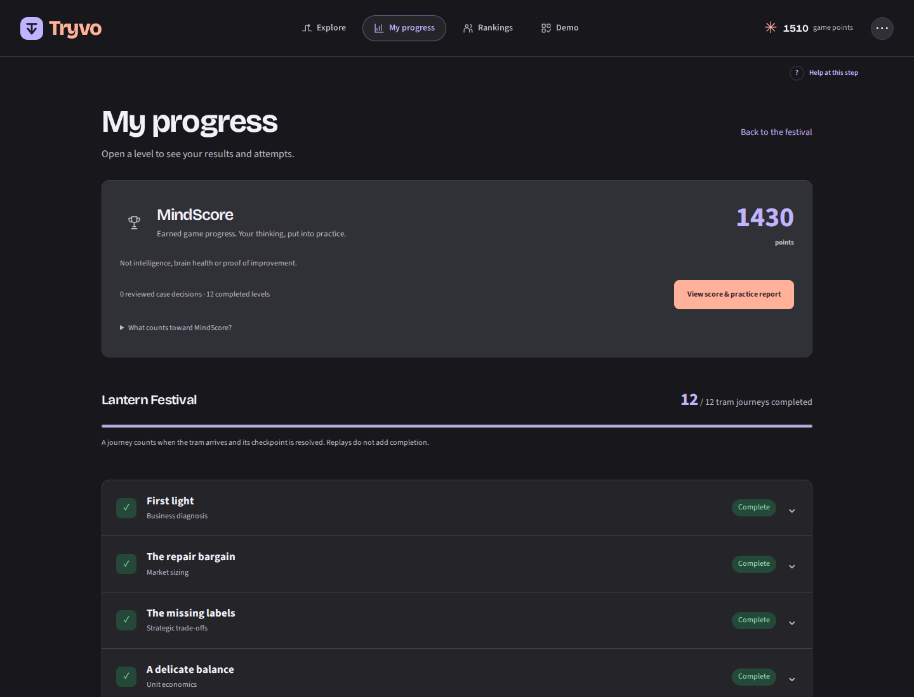
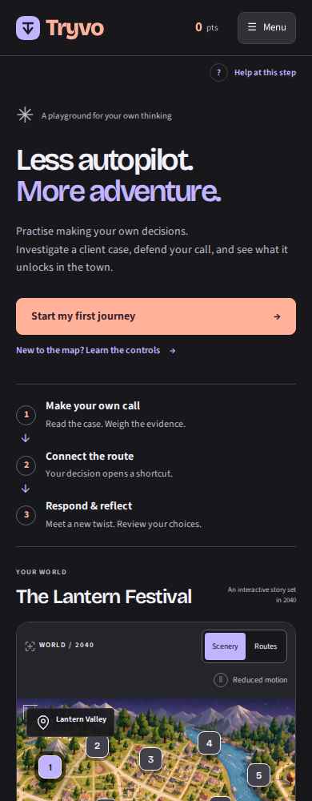
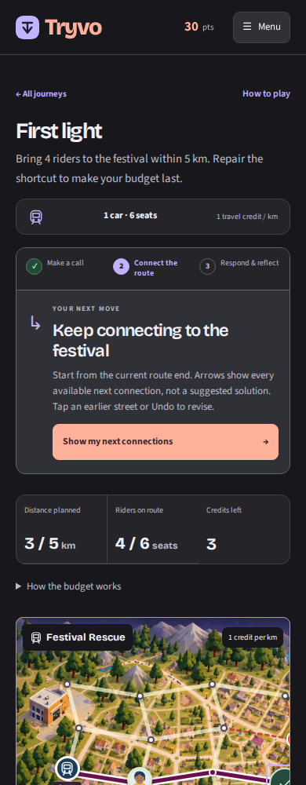

<div align="center">

# Tryvo

### Less autopilot. More adventure.

A playable world for practising your own judgment in an age of autonomous AI.

**[Open the live demo →](https://tryvu-tryvo.vercel.app/#explore)** · [Try the guided lessons](https://tryvu-tryvo.vercel.app/#demo) · [Run locally](#run-locally)

12 connected journeys · Fictional business cases · Optional AI client · Offline exercises

</div>

[](https://tryvu-tryvo.vercel.app/#explore)

## The idea

**In 2040, your personal AI agent can do almost everything for you. What will you still choose to do yourself?**

Tryvo explores one possible consequence: fewer everyday opportunities to exercise judgment and feel ownership of an outcome. Its product hypothesis is that people may value a place where their own decisions matter, even when delegation is available.

The Lantern Festival gives that practice a purpose. A client needs a decision; your recommendation reopens a tram connection. You build a route, respond to new information at arrival, and see the choices behind the result.

This is a working prototype for the **Flipkart APM product challenge**, not an official Flipkart product. The 2040 scenario and business cases are fictional; demand and learning benefits remain hypotheses to test.

## Try one complete journey

No account is required. Start with **[Explore](https://tryvu-tryvo.vercel.app/#explore) → Start my first journey**.

| Step | What you do | Why it matters |
| --- | --- | --- |
| **1. Make a call** | Read “The hotel with empty rooms” and record your first judgment. | Your own attempt comes before AI feedback. |
| **2. Investigate** | Open the exhibits; question the AI client if useful. | Separate evidence from assumptions. Chat is optional. |
| **3. Recommend** | State your decision, evidence, trade-off and next test. Revise from feedback. | A defensible recommendation unlocks the shortcut. |
| **4. Connect** | Build and run a tram route within the distance, budget and seat limits. | Your choices produce a visible consequence. |
| **5. Respond & reflect** | Address the arrival twist, then open **My progress**. | Compare what you thought, what changed and what you contributed. |

**For a dependable offline walkthrough:** open **[Demo](https://tryvu-tryvo.vercel.app/#demo)** and choose **Your first connection**. Both guided lessons work without AI. Each campaign case also offers **Use offline route exercise** for numeric route practice if the AI service is unavailable. This is an explicit alternative exercise, not a simulated AI response.

Progress is saved in the current browser. Return later using **Continue my journey**; a written first take is saved even before you lay any track.

## Inside the product

### Your judgment starts the journey

The case desk moves through **First take → Investigate → Decide → Feedback**. Each dossier contains a brief, three exhibits and an arrival development. Recommendations have four parts: decision, evidence, trade-off and a test that could change your mind.



### Decisions become connections

A current-step panel explains the next action. Arrows show every legal adjacent connection equally; they do not pick a solution. Routes have real game constraints, and the tram travels along the path you built, pausing at stops before the next decision opens.



*This route was opened through the offline exercise. The screenshot shows actual local gameplay, not an AI-reviewed recommendation.*

### A record of your contribution

**My progress** retains attempts and feedback. MindScore recognises eligible game achievements; it is **not intelligence, brain health or proof of improvement**. Recorded AI assistance stays visible, and replaying a journey cannot repeatedly earn the same award.

After an AI-reviewed case, you can request a practice report that cites the saved decisions and suggests three exercises. Reports do not change your game score.



*Demonstration progress from the repository’s offline test fixture. These totals are not user research, usage metrics or evidence of learning.*

<details>
<summary><strong>See the mobile experience</strong></summary>
<br>
<table>
<tr>
<td align="center"></td>
<td align="center"></td>
</tr>
<tr><td align="center">A clear place to begin</td><td align="center">One next action at a time</td></tr>
</table>

</details>

<details>
<summary><strong>Explore all twelve fictional cases</strong></summary>

| Case | The decision you practise |
| --- | --- |
| The hotel with empty rooms | Diagnose falling bookings before cutting prices |
| How many pens does Kota buy? | Estimate a market with segments and explicit assumptions |
| The CEO’s expansion choice | Weigh growth against operational reliability |
| A price cut with a hidden cost | Compare contribution, capacity and cannibalisation |
| The dashboard says demand is down | Separate a signal from confounding changes |
| Who gets the peak-hour tram? | Allocate capacity across competing needs |
| A city budget with no easy answer | Prioritise investments under constraints |
| The announcement that could backfire | Communicate uncertainty and protect trust |
| Sell out—or be left with stock? | Choose inventory with incomplete demand data |
| The CEO and the storm forecast | Make a contingent decision under uncertainty |
| Growth is hiding a trust problem | Balance marketplace growth, quality and fairness |
| The network you cannot build all at once | Sequence transport investments |

All figures, people and outcomes are authored scenarios. The Kota case is an estimation exercise, not a measurement of actual demand.

</details>

## What is implemented

| Working in the prototype | Boundary |
| --- | --- |
| Twelve routes, twelve case dossiers, two guided lessons and five standalone investigations | Transport, business consequences, credits and rival players are simulated. |
| Groq-powered client conversation, rubric feedback and practice reports | Requires the configured backend. AI feedback can be mistaken. |
| Server-validated case acceptance and engine-controlled route constraints / one-time awards | Browser-local progress is editable; this is not a production competitive leaderboard. |
| Saved drafts, review retries, offline exercises and arrival resume | Progress is device/browser-specific; there is no account sync. |
| Desktop/mobile layouts, keyboard controls, motion toggle and reduced-motion support | Automated Chromium checks cover selected behavior; they do not establish universal accessibility. |

**What still needs validation:** repeat demand, grading consistency, whether achievement feels personally earned, and performance on unfamiliar tasks after practice. The next useful study is unassisted first use followed by comparable unfamiliar tasks, with assistance recorded.

## Run locally

**Python 3.10+ and a modern browser.** The app uses the Python standard library; no frontend build or package installation is required to run it.

```sh
git clone https://github.com/aadishjainiitd-svg/Tryvu.git
cd Tryvu
python3 prototypes/tryvo/server.py --port 8765
```

Open **[localhost:8765](http://localhost:8765/#explore)**. On Windows, use `py` if your installation does not provide `python3`.

To enable AI locally, copy [`.env.example`](.env.example) to `.env.tryvo` in the repository root, add your Groq key, and restart the server. Keep that file private. Without a key, use the guided Demo and offline route exercises. Case text is sent to Groq only when you request AI conversation, review or a practice report.

See the **[developer guide](docs/DEVELOPMENT.md)** for configuration, Vercel/Render deployment, tests, data handling and troubleshooting.

## Built with

**HTML · CSS · vanilla JavaScript · Python · SQLite · Groq**

The frontend is hosted on Vercel; the Python API runs on Render. Authored dossiers define the facts, AI provides conversation and critique, server validation determines acceptance, and the game engine applies route rules and rewards. The interface uses local artwork and fonts, CSS/SVG and the native Web Animations API.

```text
prototypes/tryvo/
├── index.html             App shell and navigation
├── css/                   Twilight palette, layouts and motion
├── js/                    Campaign, case desk, route engine and progress
├── assets/                Town artwork, fonts and case dossiers
├── server.py              Web server and AI case API
├── report_service.py      Practice reports grounded in saved cases
└── tests/                 Engine, API and browser checks
```

## Verification and project notes

Existing checks exercise all twelve route economies, case revisions and retry recovery, saved progress, one-time awards, keyboard navigation, responsive layouts from 320–1440px, motion preferences and arrival/return transitions. AI-path browser suites use controlled responses; they do not validate live model quality. Screenshots here were captured from the actual interface with motion paused for clarity; [capture notes](prototypes/tryvo/screenshots/readme/README.md) describe their state.

- **[Run the checks](docs/DEVELOPMENT.md#tests)** — engine, API and browser commands.
- **[Design system](DESIGN.md)** — charcoal surfaces, lavender signals, coral actions and accessible motion.
- **[Product → design handoff](product/first-use-guidance.md)** — the intended decision journey, assumptions and trade-offs.
- **[Verification notes](research/first-use-guidance-verification.md)** — exercised paths and remaining limits.
- **[Business cases](prototypes/tryvo/BUSINESS-CASES.md)** · **[Route economy](prototypes/tryvo/ECONOMY.md)** · **[Guided lessons](prototypes/tryvo/DEMO-DESIGN.md)**.

## Credits

Tryvo builds on HTML5 Boilerplate and selected interaction patterns from Brad Traversy’s *50projects50days*. Existing license notices and bundled-font terms are retained. See [source attribution](prototypes/tryvo/ATTRIBUTION.md), [Boilerplate’s license](prototypes/tryvo/LICENSE.txt) and the [vendor notices](prototypes/tryvo/vendor/).
